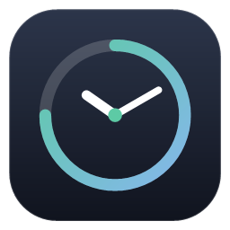
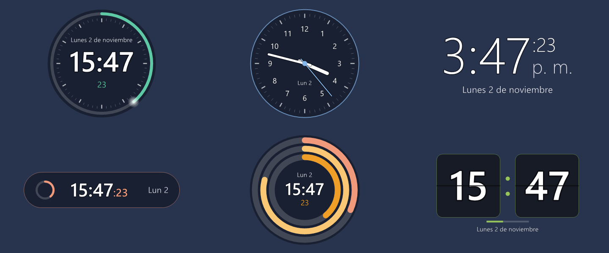
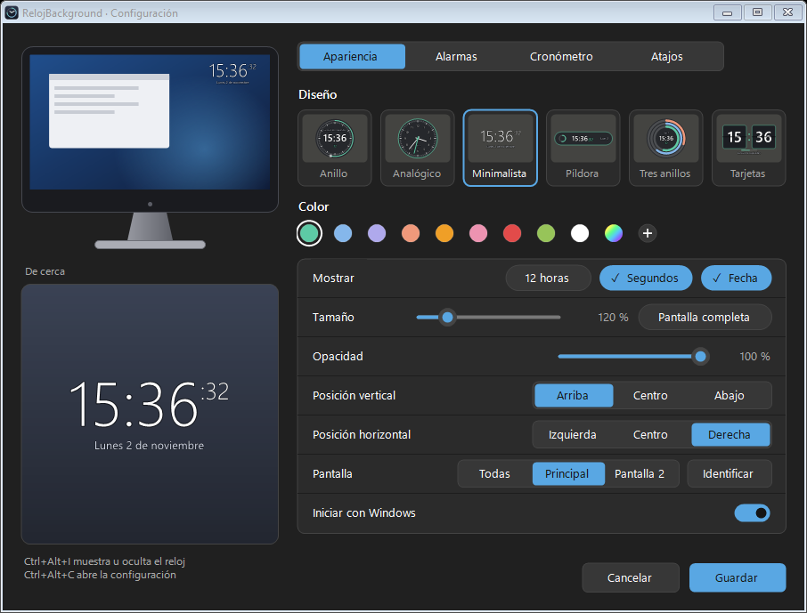
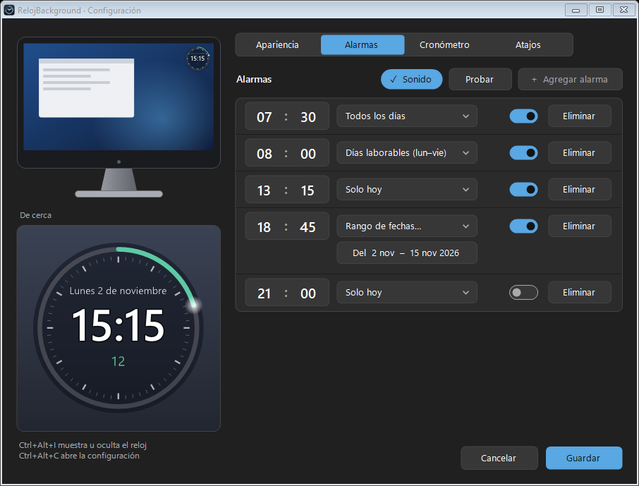
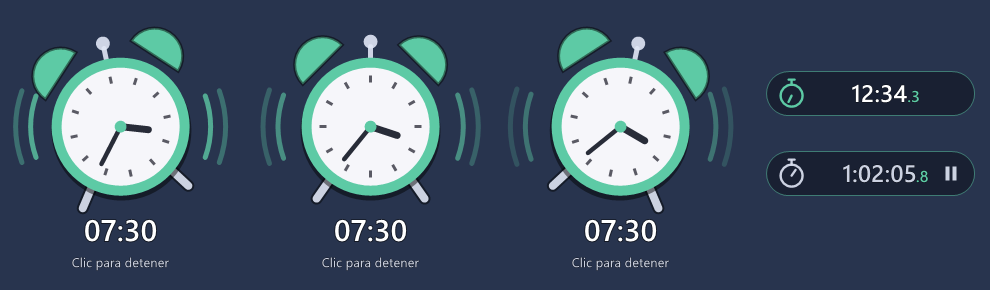
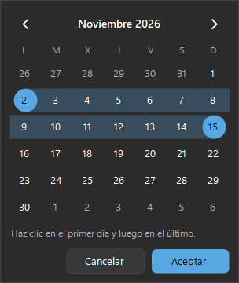

<p align="center">
  
</p>

<h1 align="center">RelojBackground</h1>

<p align="center">
  Reloj transparente que se queda siempre encima de tus ventanas, sin estorbar:<br>
  los clics pasan a lo que hay debajo y puedes seguir trabajando.<br>
  Con alarmas, cronómetro y 6 diseños. Para <b>Windows</b> y <b>macOS</b>.
</p>

<p align="center">
  <a href="https://github.com/camiloacm87/RelojBackground/releases/latest"><b>⬇ Descargar la última versión</b></a>
</p>



## Características

- **6 diseños:** Anillo, Analógico, Minimalista, Píldora compacta, Tres anillos y Tarjetas.
- **Colores:** 9 colores, Arcoíris (cambia poco a poco) o cualquier color a elección.
- **Transparente y sin estorbar:** fondo transparente, opacidad ajustable, no captura el ratón ni el teclado.
- **Tamaño y posición:** de 20 % a 500 % o pantalla completa; arriba/centro/abajo e izquierda/centro/derecha.
- **Varias pantallas:** en todas o en una concreta (con botón para identificar cada monitor).
- **Alarmas:** hasta 5, para todos los días, días laborables, solo hoy o un rango de fechas. Al sonar aparece
  un despertador animado (y un pitido opcional); se apaga con un clic sobre él.
- **Cronómetro:** aparece en una pequeña píldora debajo del reloj mientras tiene tiempo.
- **Atajos de teclado configurables:** por defecto solo `Ctrl+Alt+I` (mostrar/ocultar) y `Ctrl+Alt+C` (configuración).
- **Inicio automático** con Windows o con el Mac.
- **Configuración moderna** con vista previa en vivo y tema claro u oscuro según el sistema.

| Configuración | Alarmas |
|---|---|
|  |  |

| Despertador y cronómetro | Rango de fechas |
|---|---|
|  |  |

## Instalación

### Windows (10 y 11)
1. Descarga `RelojBackground-Windows.zip` desde [Releases](https://github.com/camiloacm87/RelojBackground/releases/latest).
2. Descomprímelo en una carpeta fija (por ejemplo `C:\Users\<tu usuario>\RelojBackground`) y abre `RelojBackground.exe`.
3. Se crea el acceso **RelojBackground** en el menú Inicio. Activa *Iniciar con Windows* en la configuración si lo quieres al encender la PC.

Windows puede mostrar un aviso de SmartScreen porque la app no está firmada: **Más información → Ejecutar de todas formas**.

### macOS (11 Big Sur o superior, Apple Silicon e Intel)
1. Descarga `RelojBackground.dmg` desde [Releases](https://github.com/camiloacm87/RelojBackground/releases/latest).
2. Ábrelo y arrastra **RelojBackground** a **Aplicaciones**.
3. La primera vez: clic derecho sobre la app → **Abrir** (no está firmada por Apple).

## Uso

| Atajo (Windows) | Atajo (Mac) | Acción |
|---|---|---|
| `Ctrl+Alt+I` | `⌃⌥I` | Mostrar / ocultar el reloj (y apagar la alarma si suena) |
| `Ctrl+Alt+C` | `⌃⌥C` | Abrir la configuración |

El resto de acciones (posición, tamaño, opacidad, cronómetro, salir) se pueden asignar a un atajo en la
pestaña **Atajos**. También está todo en el icono junto al reloj de Windows o en la barra de menús del Mac.

Desde la línea de comandos: `--config`, `--alternar`, `--mostrar`, `--ocultar`, `--salir`
(en Windows además `--pos abajo-centro`, `--escala 1.5`, `--completa`, …). Más detalles en
[windows/LEEME.md](windows/LEEME.md) y [mac/LEEME-mac.md](mac/LEEME-mac.md).

## Compilar desde el código

**Windows:** ejecuta `windows\compilar.bat`. Usa el compilador de C# que ya trae Windows (.NET Framework 4); no hay que instalar nada.

**macOS:** con las herramientas de Apple (`xcode-select --install`):
```bash
cd mac
chmod +x compilar.sh crear-dmg.sh
./crear-dmg.sh --universal
```

**Automático en GitHub:** cada cambio subido a `main` compila el `.exe` y el `.dmg` (pestaña **Actions**).
Al publicar una etiqueta de versión (`v2.1`, `v3.0`, …) se crea una **Release** con los dos instaladores adjuntos.

## Estructura

```
windows/   Código de Windows (C# / Windows Forms): RelojBackground.cs, Configuracion.cs, compilar.bat
mac/       Código de macOS (Swift / AppKit / SwiftUI), icono y scripts para crear la app y el .dmg
docs/      Capturas para este README
.github/   Compilación automática en GitHub Actions
```
